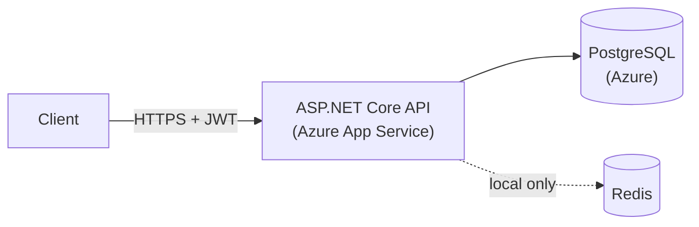
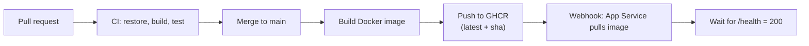

<h1 align="center">CatchLog API</h1>

<p align="center">
  A REST API for logging fishing catches, built with ASP.NET Core, PostgreSQL and Redis,<br/>
  containerized with Docker and deployed to Azure through GitHub Actions.
</p>

<p align="center">
  <a href="https://github.com/TurnGui/catchlog-api/actions/workflows/ci.yml"><strong>CI</strong></a>
  ·
  <a href="https://github.com/TurnGui/catchlog-api/actions/workflows/cd.yml"><strong>CD</strong></a>
</p>

<p align="center">
  
  
  
  
  
  
</p>

---

CatchLog lets anglers register, log the fish they catch, and see statistics per species. I built it
as a backend portfolio project, coming from Java and Spring Boot, to learn the .NET ecosystem and
to go beyond CRUD: authentication, error handling, caching, containers, cloud deployment and CI/CD.

Species are shared between all anglers. A catch belongs to the angler who logged it, and only that
angler can delete it. Protected species can only be logged as catch and release.

## Features

- **Authentication**: register and log in with JWT bearer tokens. Passwords are hashed with BCrypt.
- **Catches**: log a catch with species, weight, length, location, bait, water conditions, notes and
  a photo URL. Only the owner can delete a catch.
- **Species catalog**: a shared list of species. A species that has catches cannot be deleted.
- **Business rules**: a protected species can only be logged as catch and release.
- **Statistics**: catch count, total weight and heaviest catch per species, cached in Redis.
- **Consistent errors**: every failure is returned as an RFC 7807 `ProblemDetails` response.
- **Health check**: `/health` verifies that the API can reach the database.

## Live deployment

| Layer | Service |
|---|---|
| API | Azure App Service for Containers (Free tier) |
| Database | Azure Database for PostgreSQL Flexible Server |
| Image registry | GitHub Container Registry (`ghcr.io/turngui/catchlog-api`) |

```
https://catchlog-api-gui-erb9efh2c5fed0d5.francecentral-01.azurewebsites.net/health
```

The Free tier has no Always On, so the first request after a period of inactivity can be slow.
The Azure resources run on student credits and may be taken down at some point. Redis is not
deployed to Azure: when no Redis connection string is set, the API uses an in-memory cache instead.



## Tech stack

| | |
|---|---|
| **Backend** | C# · .NET 10 · ASP.NET Core Web API · Entity Framework Core (Npgsql) |
| **Auth** | JWT bearer · BCrypt |
| **Data** | PostgreSQL 16 · Redis 7 (`IDistributedCache`) |
| **DevOps** | Docker (multi-stage) · Docker Compose · GitHub Actions · GHCR · Azure App Service |
| **Testing** | xUnit · EF Core InMemory |

## Architecture

```
CatchLog.Api
├── Controllers     HTTP layer, no business logic
├── Services        business rules and caching, throw named exceptions
├── Data            EF Core DbContext
├── Models          Angler, Species, Catch
├── DTOs            request and response contracts
├── Exceptions      named exceptions mapped to HTTP statuses
├── Handlers        global exception handler (ProblemDetails)
├── Extensions      helpers such as reading the angler id from the token
└── Migrations      EF Core migrations, applied at startup
```

Controllers call services and services use EF Core. Services signal failures by throwing named
exceptions, and one global handler maps them to HTTP responses:

| Exception | Status |
|---|---|
| `NotFoundException` (a referenced resource does not exist) | 400 |
| `ConflictException` | 409 |
| `ForbiddenException` | 403 |
| `BusinessRuleException` | 422 |
| anything else | 500 (logged, details hidden from the client) |

A resource requested directly by id that does not exist returns a plain 404.

Species statistics use the cache-aside pattern: the result is cached for 5 minutes and the entry is
removed whenever a catch is created or deleted.

### API overview

Every route requires a `Bearer` token except `POST /api/anglers` (register), `POST /api/auth/login`
and `GET /health`.

| Method | Endpoint | Description |
|---|---|---|
| POST | `/api/anglers` | Register an angler |
| POST | `/api/auth/login` | Log in, returns a JWT |
| GET | `/api/anglers` | List anglers |
| GET | `/api/anglers/{id}` | Get an angler |
| PUT | `/api/anglers/{id}` | Update your own account |
| DELETE | `/api/anglers/{id}` | Delete your own account and its catches |
| GET | `/api/species` | List species |
| GET | `/api/species/{id}` | Get a species |
| POST | `/api/species` | Create a species |
| DELETE | `/api/species/{id}` | Delete a species that has no catches |
| GET | `/api/catches` | List catches |
| GET | `/api/catches/{id}` | Get a catch |
| POST | `/api/catches` | Log a catch for the logged-in angler |
| DELETE | `/api/catches/{id}` | Delete your own catch |
| GET | `/api/statistics/species` | Statistics per species (cached) |
| GET | `/health` | Health check |

In development the OpenAPI document is served at `/openapi/v1.json`.

## CI/CD



- **CI** runs on every pull request and on pushes to `dev` and `main`.
- **CD** runs on pushes to `main`. It builds the image, pushes it to GHCR with the built-in
  `GITHUB_TOKEN`, calls the App Service webhook and polls `/health` until the app is up.
- Work happens on `feature/*` branches that are merged into `dev` through pull requests. `dev` is
  merged into `main` for each versioned release.

## Getting started

**Requirements:** .NET 10 SDK and Docker.

### Option 1: everything in Docker

```bash
echo "JWT_KEY=$(openssl rand -base64 48)" > .env
docker compose up --build
```

The API is available at `http://localhost:8081`. Migrations run at startup.

### Option 2: API on the host, dependencies in Docker

```bash
docker compose up -d postgres redis
cd CatchLog.Api
export Jwt__Key="$(openssl rand -base64 48)"
dotnet run
```

In the `Development` environment the API uses PostgreSQL on `localhost:5544` and Redis on
`localhost:6380`.

### Try it

```bash
BASE=http://localhost:8081

curl -X POST $BASE/api/anglers -H "Content-Type: application/json" \
  -d '{"name":"Test","email":"test@mail.com","password":"pass1234"}'

TOKEN=$(curl -s -X POST $BASE/api/auth/login -H "Content-Type: application/json" \
  -d '{"email":"test@mail.com","password":"pass1234"}' | python3 -c "import sys,json;print(json.load(sys.stdin)['token'])")

curl -X POST $BASE/api/species -H "Authorization: Bearer $TOKEN" -H "Content-Type: application/json" \
  -d '{"commonName":"Brown Trout","scientificName":"Salmo trutta","isProtected":false}'

curl -X POST $BASE/api/catches -H "Authorization: Bearer $TOKEN" -H "Content-Type: application/json" \
  -d '{"speciesId":1,"weightKg":1.2,"lengthCm":40,"location":"Minho River","caughtAt":"2026-10-12T10:00:00Z","isCatchAndRelease":false}'

curl $BASE/api/statistics/species -H "Authorization: Bearer $TOKEN"
```

### Configuration

| Setting | Purpose |
|---|---|
| `ConnectionStrings__DefaultConnection` | PostgreSQL connection string |
| `ConnectionStrings__Redis` | Redis connection string. If empty, an in-memory cache is used |
| `Jwt__Key` | HMAC signing key for JWTs (required) |
| `Jwt__Issuer`, `Jwt__Audience`, `Jwt__ExpiresMinutes` | Token settings (defaults in `appsettings.json`) |

## Testing

```bash
dotnet test
```

12 tests cover the service layer with the EF Core InMemory provider: password hashing, email
conflicts, ownership checks, the protected species rule, species deletion rules and cache
invalidation. CI runs them on every pull request.

## Roadmap

| Phase | Topic | Status |
|---|---|---|
| 1 | Domain entities, DbContext, PostgreSQL with Docker Compose | Done |
| 2 | Angler CRUD and password hashing | Done |
| 3 | Species and Catch CRUD | Done |
| 4 | JWT authentication | Done |
| 5 | Protected species rule and statistics | Done |
| 6 | Unit tests | Done |
| 7 | Global error handling and health check | Done |
| 8 | Redis caching | Done |
| 9 | Docker and Azure deployment | Done |
| 10 | CI/CD with GitHub Actions | Done |
| 11 | Documentation | Done |

Possible next steps: roles for admin-only species management, statistics per angler, a change
password endpoint, running migrations from the pipeline instead of at startup, and degrading
gracefully when Redis is unavailable.

## Known limitations

- There is no input validation on the request bodies yet, so empty names or negative weights are
  accepted.
- Any authenticated user can create and delete species. There are no roles.
- Lists are not paginated, and the angler, catch and statistics endpoints return data for all users.
- Migrations are applied when the app starts, which is fine for one instance but not for several.
- If a Redis connection string is configured and Redis goes down, the endpoints that use the cache
  return 500 instead of falling back to the database.
- The deployment uses the Free App Service tier, so there is a cold start and a daily CPU quota.
- JWTs are not refreshed and there is no password reset flow.